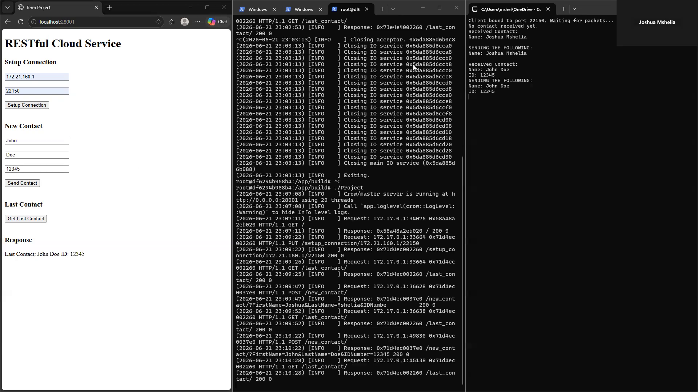
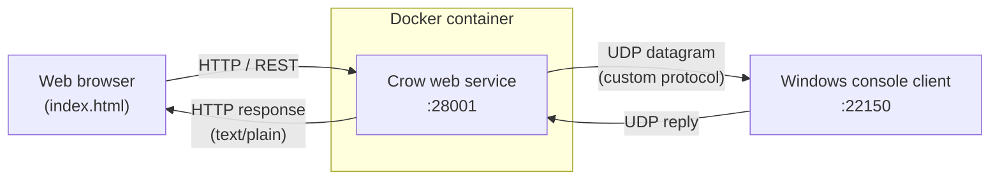
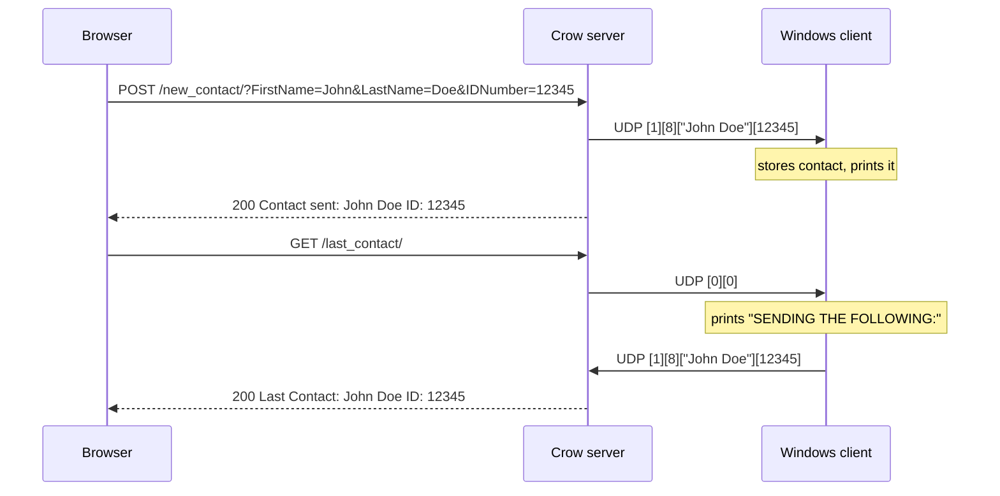

# RESTful UDP Gateway

A three-tier networked application in C++. It connects a **web browser** to a **Windows console client** through a **RESTful web service running in Docker**. The browser talks HTTP to the server. The server turns each request into a packet in a custom binary **application-layer protocol** and exchanges it with the Windows client over UDP.

Built for CSCN72050 (Mobile and Networked Systems) at Conestoga College.



## Architecture



| Tier | Tech | Source |
|---|---|---|
| Client 1: browser UI | HTML + `fetch` | [`server/public/index.html`](server/public/index.html) |
| Server: REST service | C++17, [Crow](https://crowcpp.org), POSIX sockets, Docker | [`server/main.cpp`](server/main.cpp) |
| Client 2: remote client | C++17, Winsock2 (UDP) | [`client/Client.cpp`](client/Client.cpp) |
| Shared protocol | C++17 header used by both programs | [`common/protocol.h`](common/protocol.h) |

## REST API

| Method | Route | Description |
|---|---|---|
| `GET` | `/` | Serves the browser UI |
| `PUT` | `/setup_connection/<ip>/<port>` | Sets the IP/port the server uses to reach the Windows client over UDP |
| `POST` | `/new_contact/?FirstName=&LastName=&IDNumber=` | Builds a `PersonData` packet and sends it to the client |
| `GET` | `/last_contact/` | Asks the client for the last contact it received and returns it as plain text |

Errors come back as clear status codes: `400` for bad or missing parameters, `409` when the connection hasn't been set up, `504` when the client doesn't reply within 3 seconds, and `502` for a malformed reply.

## Application-layer protocol

```cpp
struct Header {
    unsigned char Flag;  // 0 = request last PersonData, 1 = data transmission
    unsigned char Size;  // number of bytes in Name (0 when Flag = 0)
};

struct PersonData {
    char*        Name;      // variable length, Size bytes, not null-terminated
    unsigned int IDNumber;  // 4 bytes
};

struct Pkt {
    Header     Head;  // always present
    PersonData Body;  // only present when Flag = 1
};
```

**On the wire**

```
Request (Flag = 0):   [Flag][Size=0]                          2 bytes
Data    (Flag = 1):   [Flag][Size][ Name ... (Size bytes) ][IDNumber (4 bytes)]
```

**Design decisions**
- The protocol has exactly two operations, *send a contact* and *request the last contact*. A one-byte `Flag` is enough to tell them apart.
- `Name` has variable length, so the header carries its byte count. The receiver then knows exactly how much to read, and no terminator is needed.
- Request packets have no body. They are just the 2-byte header.
- The receiver checks every packet against the real datagram length before reading the body. A truncated or malformed packet is rejected instead of being over-read.

**Exchange**



## Running it

**1. Start the server (Docker)**

```bash
docker build -f server/Dockerfile -t restful-udp-gateway .
docker run --rm -p 28001:28001 restful-udp-gateway
```

The Dockerfile downloads the Crow single header and builds with CMake.

**2. Start the Windows client**

Open `client/Client.cpp` in Visual Studio as a console app (add `common/` to the include path) and run it. You can also build it with MinGW:

```bash
g++ -std=c++17 client/Client.cpp -o Client.exe -lws2_32
```

It binds to UDP port **22150**.

**3. Use the browser**

1. Open `http://localhost:28001`.
2. Under **Setup Connection**, enter the Windows host's IP **as seen from the container** and port `22150`. On Docker Desktop with WSL 2, this is the `vEthernet (WSL)` address from `ipconfig`.
3. Send contacts and request the last contact.

## Notes

- The server is multithreaded (Crow). Shared UDP settings are protected with a mutex.
- `/last_contact/` uses a fresh ephemeral UDP socket for each request with a receive timeout, so a missing client can't hang the HTTP request.
- `AppPacket` lives in `common/protocol.h` and is shared by the server and client, so both sides apply the same validation. It stores its data in `std::string`/`std::vector`, so there is no manual memory management.

## Author

Joshua Mshelia · [GitHub](https://github.com/msheliaJ)
